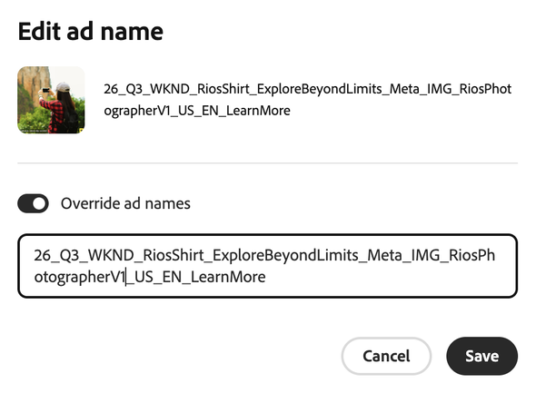

# Generate ad names

Automated ad naming in [!DNL GenStudio for Performance Marketing] helps you follow your organization's naming conventions when you activate ads. Consistent names support performance reporting, attribution, and spend reconciliation.

A naming template defines the parts of an ad name, such as product, campaign, and market, and the order in which they appear. You create a template by uploading an Excel file that describes your organization's naming convention.

Use the template to generate names from information about each experience, such as its product or campaign. Review and correct the results before sending your ads. The final names are sent to each destination platform as the ad names.

## Before you begin

You only need to set up a template once. If your platform already has a template assigned in your current Project, skip to [Generate names for an activation](#generate-names-for-an-activation).

Otherwise, create a template and ask a system manager to [assign it to your platforms](#assign-a-template-to-platforms). Each Project can have a different default template for the same platform.

For template setup, prepare an Excel file no larger than 3 MB, with only one sheet. CSV files are not supported. Describe the naming convention for individual ads, not campaigns or ad groups.

Include the fields in their required order, allowed values, corresponding codes, and instructions for choosing values. For example, selecting `Image` for the `format` field can produce `IMG` in the name.

Download the [WKND Meta naming convention example (Excel)](assets/wknd-meta-naming-convention.xlsx) to explore a sample structure. It includes field definitions and example values for year, quarter, brand, product, campaign, platform, format, creative version, persona, market, language, and CTA.

Replace the sample values and rules with your organization's convention before using the file for your own activations. The example's platform values illustrate naming choices, not a list of supported activation destinations.

## Create a naming template

Create a template from your existing naming-convention file, then review the extracted structure before you use it.

1. Open the Project where you want to use the template.
1. Go to **[!UICONTROL More]** > **[!UICONTROL Settings]**.
1. Select **[!UICONTROL Set up]** beside **[!UICONTROL Ad name template]**.

   If templates already exist, open **[!UICONTROL Ad name template]**, then select **[!UICONTROL Create template]**.

1. Select **[!UICONTROL Select file]** in the **[!UICONTROL Upload file]** dialog.
1. Choose your Excel file.

   You can also drag the file into the upload area. While **[!UICONTROL Analyzing your spreadsheet...]** appears, the fields and values are mapped to your template. This may take a few minutes.

1. Review the fields, allowed values, and **[!UICONTROL Ad name preview]**.

   The preview uses sample values, not the details of a specific ad.

1. Select **[!UICONTROL Save]**.

Files larger than 3 MB, unsupported file types, and empty files show an error without changing existing templates or platform assignments.

## Customize a template

Edit a saved template to adjust its name, fields, separator, or rules.

1. Go to **[!UICONTROL More]** > **[!UICONTROL Settings]** > **[!UICONTROL Ad name template]**.
1. Open the three-dot menu beside your template.
1. Select **[!UICONTROL Edit]**.
1. Select the pencil icon beside the title to rename the template.
1. Set the **[!UICONTROL Field separator]** to the character that separates the parts of the name, such as an underscore (`_`).
1. Drag the fields into the required order.

   Use **[!UICONTROL Add field]** or a field's trash icon if you need to change which fields are included.

1. Select a field's pencil icon to open its settings.
1. Review **[!UICONTROL Type]** and **[!UICONTROL Name]** in the **[!UICONTROL Edit a field]** dialog.

   Use **[!UICONTROL Dropdown]** for a field with predefined choices or **[!UICONTROL Free text]** for a value that you enter.

1. For a dropdown field, review **[!UICONTROL Options]** and **[!UICONTROL Code]**.

   **[!UICONTROL Options]** contains the readable choices. **[!UICONTROL Code]** contains the corresponding values used in the ad name. For example, the option `Image` uses the code `IMG`.

   Use **[!UICONTROL Add option]** to add a choice, or the minus icon beside a choice to remove it. Duplicate values within a field are not allowed.

1. Enter any **[!UICONTROL Field rules]** needed to choose or format that field's value.

   For the example's `creativeVersion` free-text field, you can enter `Use the experience name as a starting value, with spaces removed.`

1. Select **[!UICONTROL Save]** in the field dialog.

   Repeat the field review for any other fields that need changes.

1. Enter any **[!UICONTROL Template rules]** that apply across the name.

   For example, enter `Remove spaces from Product and Campaign values.`

1. Select **[!UICONTROL Save]** at the top of the page.

The preview reflects the updated field order and separator. Reopen the template to check your saved changes.

The field editor shows how readable options map to the codes included in generated names:

## Assign a template to platforms

System managers set the default template for each platform within a Project. If you are not a system manager, ask one to complete this procedure.

1. Open the Project whose platform defaults you want to set.
1. Go to **[!UICONTROL More]** > **[!UICONTROL Settings]** > **[!UICONTROL Ad name template]**.
1. Open the three-dot menu beside your template.
1. Select **[!UICONTROL Edit]**.
1. Select one or more platforms under **[!UICONTROL Preferred platforms]** at the bottom of the editor.
1. Select **[!UICONTROL Save]**.

Each platform has one default template per Project. You can assign the same template to several platforms.

You can view and edit templates across Projects, but you can change assignments only for the Project you are currently in.

Replacing a platform's default does not delete the previous template or change other Projects' assignments.

The example below shows the template preview, field order, rules, and **[!UICONTROL Preferred platforms]** with Meta Ads selected:

## Generate names for an activation

Prepare your activation before generating names. Review each experience's metadata, the information about its campaign, product, or persona, to make sure your template has the values it needs. See [Activation workflow](create-activation.md) for help preparing an activation.

1. Open **[!UICONTROL Activate]** in the intended Project.
1. Add your experiences to an activation.
1. Complete the platform setup and all required information, including copy, call-to-action (CTA), and website URL.
1. Check that the experiences have the metadata needed by your naming convention.
1. Select **[!UICONTROL Generate ad name]** above the activation table.

   Wait for **[!UICONTROL Generating ad names]** to finish before reviewing the results.

1. Review the **[!UICONTROL Ad name]** column.

Generation applies to all ads on platforms with an assigned template, except ads with [custom name overrides](#use-a-custom-ad-name). Names are not generated automatically when you open the table.

Initially, each ad uses its experience's name. If a platform has no assigned template, generation leaves its names unchanged, and you can edit them manually.

If no platforms have templates assigned, no names are generated.

## Correct an individual ad name

Review generated names before you send your ads. Missing values appear as highlighted field placeholders, such as `[market]`, and the affected ads show **[!UICONTROL Needs attention]**.

The activation table flags names with missing values so you can find and correct them:

1. Select the ad's row in the activation table.
1. Select **[!UICONTROL Edit ad name]**.
1. Update the relevant dropdowns or text fields.
1. Select **[!UICONTROL Save]**.

For example, if `market` has no value, enter or select the appropriate market to replace `[market]` in the name.

Check the updated name against your convention.

## Resolve potential duplicate names

Identical ad names on the same platform are flagged as potential duplicates.

1. Select one of the affected ads.
1. Select **[!UICONTROL Edit ad name]**.
1. Change the name so that the two names are different.
1. Select **[!UICONTROL Save]**.

The potential-duplicate warning clears after the names are made different.

## Edit several ad names at once

Use bulk editing to apply a shared correction without replacing values that should remain different for each ad.

1. Select the ads using their row checkboxes.
1. Select **[!UICONTROL Edit ad name]** from the selection toolbar.
1. Change only the fields that should have the same value across the selected ads.

   **[!UICONTROL Mixed values]** means that the selected ads currently have different values for a field. Leave that field untouched to preserve each ad's value.

1. Select **[!UICONTROL Save]**.
1. Review the updated names for accuracy and potential duplicates.

Only selected ads are updated. Unselected ads remain unchanged.

The bulk editor displays **[!UICONTROL Mixed values]** for fields that differ across the selected ads:

For example, changing only the persona from `OutdoorBeginners` to `Adventurers` preserves the different products. These shortened names illustrate the change:

| Before | After |
| --- | --- |
| `WKND_TrailBag_OutdoorBeginners` | `WKND_TrailBag_Adventurers` |
| `WKND_RiosShirt_OutdoorBeginners` | `WKND_RiosShirt_Adventurers` |

## Use a custom ad name

Use an override to replace the entire generated name with a custom name, rather than editing individual template fields.

1. Select the ad's row.
1. Select **[!UICONTROL Edit ad name]**.
1. Turn on **[!UICONTROL Override ad names]**.
1. Enter the custom name.
1. Select **[!UICONTROL Save]**.

The custom name stays unchanged when you generate names again.

With the override enabled, you can edit the complete name instead of its individual template fields:

To return to template-based naming, follow these steps:

1. Open **[!UICONTROL Edit ad name]** for the ad.
1. Turn off **[!UICONTROL Override ad names]**.
1. Select **[!UICONTROL Save]**.
1. Select **[!UICONTROL Generate ad name]** above the activation table.

This action also regenerates names for other ads in the table that have an assigned template and no custom name override.

## Respond to template changes

When you edit an activation table, a warning appears if a template it uses has changed or been deleted.

If the template has changed, review the updated template before you regenerate names. Select **[!UICONTROL Generate ad name]** to apply it.

If the template has been deleted or you need a replacement, follow these steps:

1. Ask a system manager to assign a replacement template to the affected platform in the same Project.
1. Return to the activation table.
1. Select **[!UICONTROL Generate ad name]**.
1. Review the updated names.

Names with overrides enabled remain unchanged during regeneration.

## Send ads to platforms

Review your final names and address unresolved fields, potential duplicates, and other **[!UICONTROL Needs attention]** issues before you send ads.

When the activation is ready, select **[!UICONTROL Send to platforms]**.

[!DNL GenStudio for Performance Marketing] sends each ad's final name to the destination platform as its ad name. This includes generated names, names edited through template fields, and custom name overrides. The ad names on the platform exactly match the final names you reviewed.

For display destinations such as Innovid, names appear as creative names.
